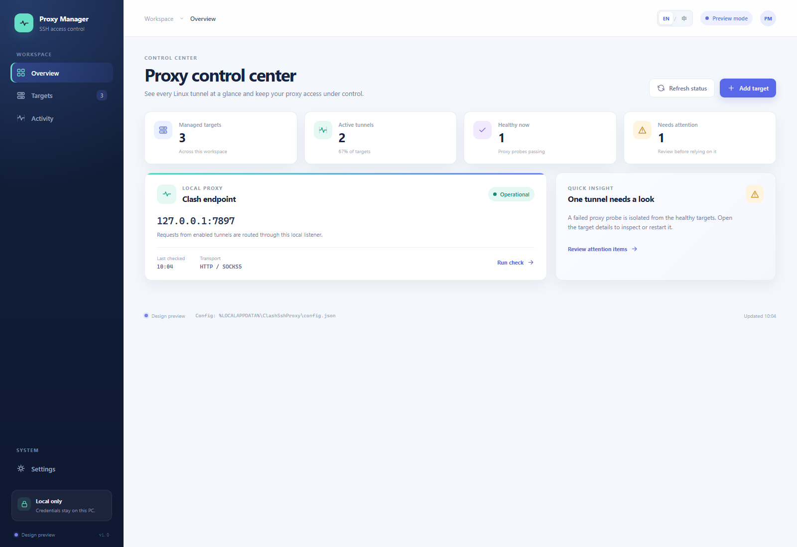
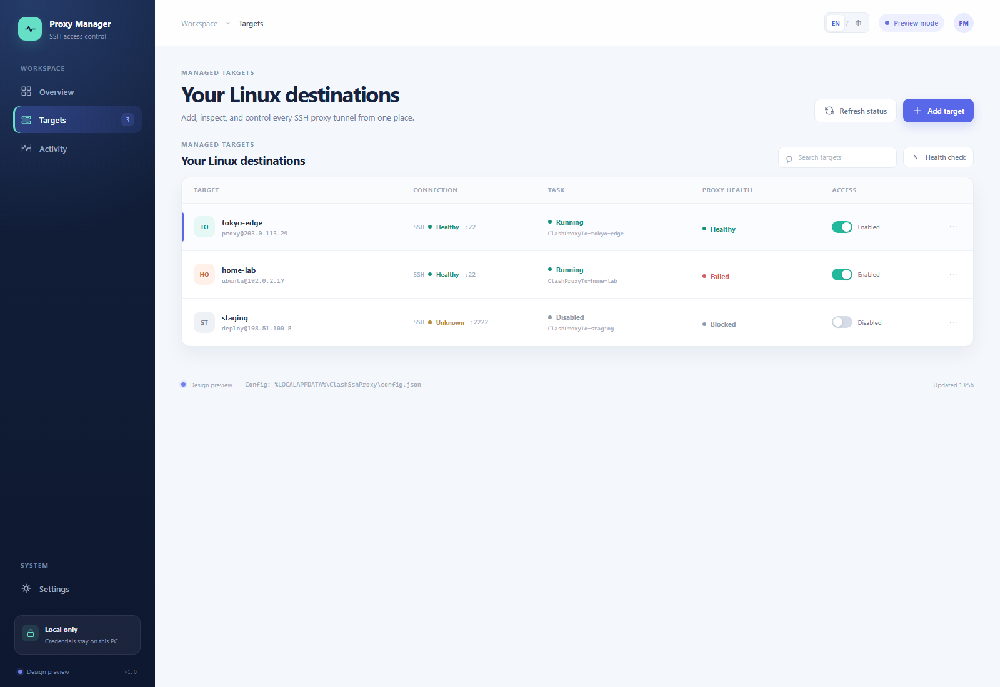
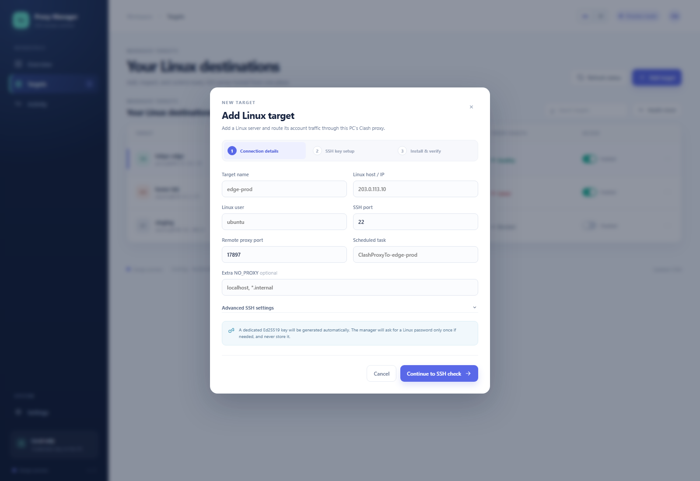
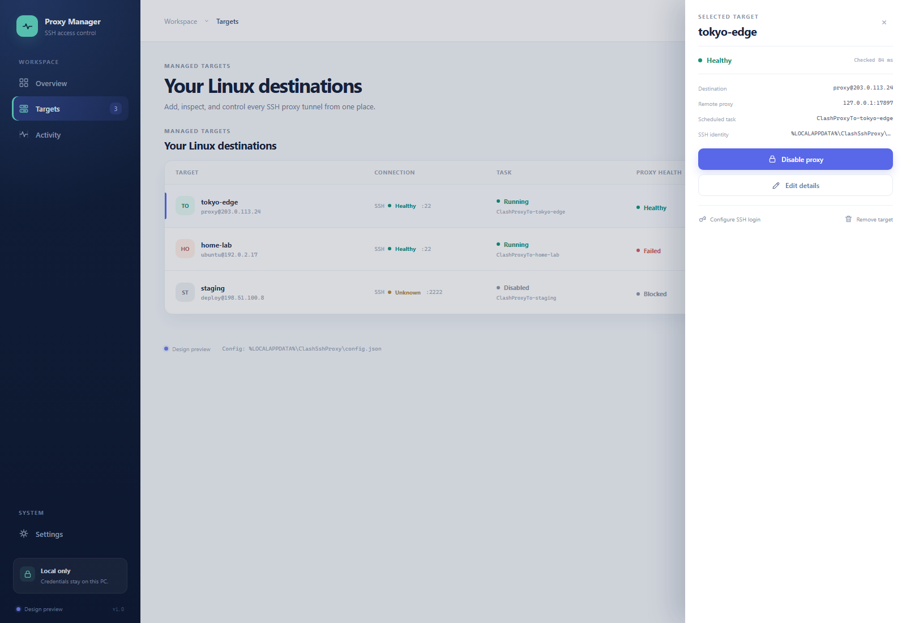
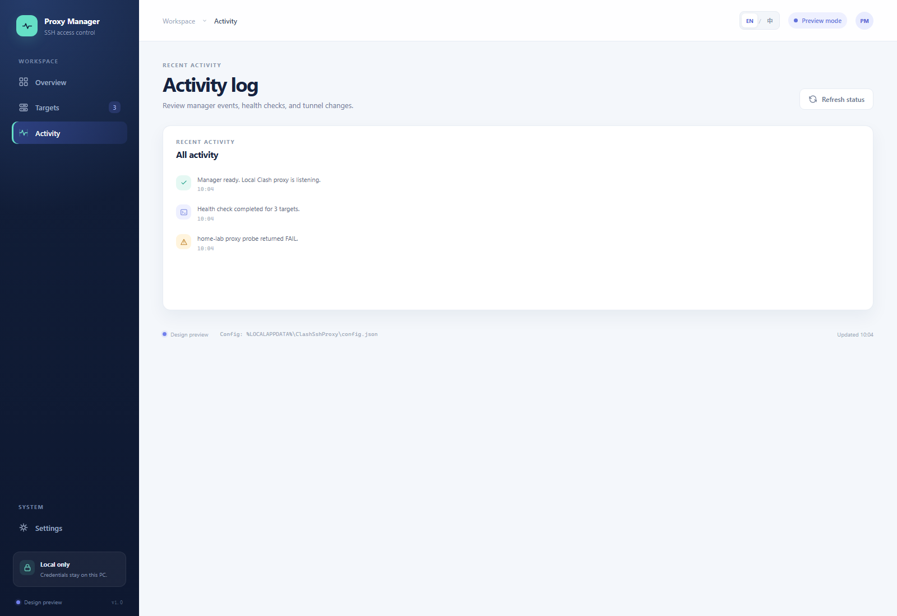

<div align="center">
  <p>
    <strong>English</strong> · <a href="README.zh-CN.md">简体中文</a>
  </p>
  <h1>Clash SSH Proxy Manager</h1>
  <p><strong>A clean local UI for managing SSH proxy tunnels from Windows to remote Linux hosts through Clash.</strong></p>
  <p>
    <a href="https://github.com/Scrates1/clash-ssh-proxy-bootstrap/releases/download/v1.2.0/clash-ssh-proxy-bootstrap-1.2.0.zip"><strong>Download v1.2.0 ZIP</strong></a>
    ·
    <a href="https://github.com/Scrates1/clash-ssh-proxy-bootstrap/releases/latest">Releases</a>
    ·
    <a href="docs/WINDOWS-UI.en-US.md">UI Guide</a>
    ·
    <a href="docs/ARCHITECTURE.en-US.md">Architecture</a>
    ·
    <a href="https://github.com/Scrates1/clash-ssh-proxy-bootstrap/issues">Issues</a>
  </p>
  <p>
    <a href="https://github.com/Scrates1/clash-ssh-proxy-bootstrap/releases/latest"></a>
    <a href="https://github.com/Scrates1/clash-ssh-proxy-bootstrap/actions/workflows/ci.yml"></a>
    
    
    
  </p>
</div>

<p align="center">
  
</p>
<p align="center"><sub>Overview, tunnel health, and the local Clash endpoint in one window. The screenshot uses documentation-only preview data.</sub></p>

> [!IMPORTANT]
> No web server deployment or Node.js installation is required. Download the release ZIP, extract it,
> and double-click `Open-ProxyManager.vbs`. The UI handles remote script installation and tunnel onboarding
> only when you add a Linux target.

## What it solves

This is a local Windows manager for routing account traffic from remote Linux hosts through your local
Clash proxy over SSH reverse tunnels. Targets are isolated: enabling, disabling, updating, or removing
one target does not affect the others.

| Local control | Target isolation | Secure defaults |
| --- | --- | --- |
| One React dashboard for overview, targets, and activity | Each target has its own task, tunnel, and SSH key | Manager and proxy endpoints are loopback-only |
| UI-led SSH checks, installation, startup, and health verification | Target access can be enabled or disabled independently | Passwords are not stored and private keys stay local |

## Start in 3 minutes

### 1. Download and launch

1. Download [clash-ssh-proxy-bootstrap-1.2.0.zip](https://github.com/Scrates1/clash-ssh-proxy-bootstrap/releases/download/v1.2.0/clash-ssh-proxy-bootstrap-1.2.0.zip) (or browse [GitHub Releases](https://github.com/Scrates1/clash-ssh-proxy-bootstrap/releases/latest)) and extract it.
2. Keep `Open-ProxyManager.vbs`, `web/dist`, and the other files in their original directory layout.
3. Double-click `Open-ProxyManager.vbs`.
4. Approve the Windows UAC prompt; the local React UI opens automatically.

Normal use does not require npm, Node.js, Docker, a database, or a separate web server. `Open-ProxyManager.cmd`
is available as a fallback launcher, though VBS is preferred to avoid a brief console flash.

When you close the window (`X`), if background proxy tunnels are active, the manager minimizes to the Windows
system tray (click the tray icon to reopen; right-click to **Exit (Keep Tunnels Running)** or
**Stop All Tunnels & Exit**). If no tunnels are active, the tray host exits automatically.

### 2. Check the prerequisites

- Windows 10 or Windows 11.
- Windows OpenSSH Client (`ssh.exe`, `scp.exe`, and `ssh-keygen.exe`).
- Clash or an HTTP-compatible mixed proxy listening on `127.0.0.1:7897`.
- A reachable SSH account on the Linux target; root is not required.
- OpenSSH server, Bash, `curl`, and standard GNU tools (`timeout`, `awk`, `mktemp`) on Linux.

### 3. Add the first Linux target in the UI

1. Open **Targets** and click **Add target**.
2. Enter the target name, Linux host/IP, Linux user, SSH port, and remote proxy port.
3. Leave the private-key path under **Advanced SSH settings** empty so the manager creates a dedicated
   Ed25519 identity for this target.
4. Click **Continue to SSH check**.
5. If the remote account has not accepted the public key yet, click **Open SSH setup**. In the temporary
   PowerShell window, if SSH asks to trust the host for the first time (`yes/no`), type `yes` and press Enter
   first, then type or paste the Linux password once at the password prompt and press Enter. Password
   characters stay hidden (use right-click or `Shift+Insert` if `Ctrl+V` does not paste) and are never stored.
6. Return to the wizard, click **Verify SSH**, and wait for **Install & verify** to finish.
7. After onboarding, enable or disable the target and inspect its health from the target list.

The wizard installs the Linux runtime scripts, creates the Windows scheduled task, starts the reverse
tunnel, and verifies end-to-end proxy traffic.

### 4. Use the proxy on Linux

New Bash login sessions enable the proxy automatically. In an already open Bash terminal, load it once with
`source ~/.bashrc`:

```bash
source ~/.bashrc   # load into an already open shell
proxy_status       # verify end-to-end reverse tunnel connectivity
proxy_off          # temporarily disable proxy variables in this shell
proxy_on           # re-enable proxy variables in this shell
```

## UI workflow

<table>
  <tr>
    <td width="50%" valign="top">
      
      <p><strong>Targets</strong><br>Inspect SSH, scheduled-task, proxy-health, and access states.</p>
    </td>
    <td width="50%" valign="top">
      
      <p><strong>Add target</strong><br>Follow Connection details → SSH key → Install & verify.</p>
    </td>
  </tr>
  <tr>
    <td width="50%" valign="top">
      
      <p><strong>Target details</strong><br>Edit, enable, configure SSH login, restart, or remove one target.</p>
    </td>
    <td width="50%" valign="top">
      
      <p><strong>Activity</strong><br>Review health checks, tunnel changes, and manager events.</p>
    </td>
  </tr>
</table>

## The four pages

| Page | What you can do |
| --- | --- |
| Overview | Check the local Clash endpoint, active tunnels, health, and attention items |
| Targets | Add, inspect, edit, enable, disable, check, or remove targets |
| Activity | Review health checks, recovery, enable/disable, and removal events |
| Settings | Switch between English and Chinese, and manage release update reminders (Remind later, Skip version, Don't remind again) |

Clicking a target row opens a separate target detail drawer; the page does not jump or scroll to another
section. Refresh keeps the current layout and loads real local manager state instead of placeholder devices.

## Keys and security

- Every target receives a stable target ID and a dedicated local Ed25519 private key.
- Exact duplicate detection uses server address + user; SSH port is a connection setting, not target identity.
- Windows keeps the private key; the Linux account receives the matching public key.
- Removing a target explicitly asks whether a manager-generated dedicated key should also be deleted
  (and supports local-only removal if a remote host is already offline or decommissioned); external keys are never deleted.
- The manager bridge and Linux proxy endpoint listen only on `127.0.0.1`.
- The Linux account itself is never deleted, and disabling one target does not affect other servers.

## CLI and AI Agent integration

Every operation is also available through `proxy-manager.ps1` as the single source of truth, with structured `-Json` output for automation and AI coding agents:

- **One-command diagnostics**: `.\proxy-manager.ps1 doctor` (or `-Json`) checks configuration validity, elevation status, local Clash reachability, target tunnel health, and unused managed key files without modifying state.
- **Passwordless / cloud server onboarding**: When a Linux server disables SSH password login and you already have an authorized local key, pass `-BootstrapIdentityFile ~/.ssh/id_ed25519` (or use the optional key option in the UI SSH wizard) to deploy the **newly generated dedicated public key** non-interactively without ever storing your existing key in `config.json`:
  ```powershell
  $prep = .\proxy-manager.ps1 prepare-ssh -Name edge-prod -RemoteHost 203.0.113.10 -RemoteUser ubuntu -Json | ConvertFrom-Json
  .\proxy-manager.ps1 bootstrap-key -Name edge-prod -TargetId $prep.TargetId -RemoteHost 203.0.113.10 -RemoteUser ubuntu -BootstrapIdentityFile ~/.ssh/id_ed25519 -Json
  .\proxy-manager.ps1 add -Name edge-prod -TargetId $prep.TargetId -RemoteHost 203.0.113.10 -RemoteUser ubuntu -Confirm:$false -Json
  ```
- **Built-in agent contract**: [AGENTS.md](AGENTS.md) and [skills/clash-ssh-proxy/SKILL.md](skills/clash-ssh-proxy/SKILL.md) instruct coding agents (Antigravity, Codex, Claude Code, Cursor) to use `proxy-manager.ps1`, keep per-target managed keys isolated, and verify changes with `validate-config` and `status`.

## FAQ

### Which launcher should I use, and how do I reopen the window?

Use `Open-ProxyManager.vbs` (`Open-ProxyManager-React.vbs` opens the same interface). Closing the window (`X`)
minimizes to the Windows system tray when background tunnels are active, and never stops enabled tunnels.
Click the tray icon or double-click `Open-ProxyManager.vbs` again at any time to reopen the UI.

### Is deployment required?

No manager deployment is required. This is a local Windows application: download, extract, and launch it.
Remote installation during **Add target** only onboards a Linux account to the proxy tunnel; it is not web
server deployment.

### Why does a PowerShell window appear during the first target setup?

Only when the remote account has not accepted the SSH public key yet. If SSH asks to trust the host for the
first time (`yes/no`), type `yes` and press Enter first; once the password prompt appears, type or paste the
Linux password and press Enter. SSH password input does not echo characters or asterisks (use right-click or
`Shift+Insert` if `Ctrl+V` does not paste). The password is never saved.

### The local Clash endpoint is offline or uses a different port

Start Clash, confirm that its mixed proxy listens on `127.0.0.1:7897`, and click **Refresh status** on
**Overview**. If your local proxy listens on another port (such as `7890`), update `proxy.localPort` in
`%LOCALAPPDATA%\ClashSshProxy\config.json` (and run `.\proxy-manager.ps1 update-all` if targets already exist).

### Where can I troubleshoot?

- [English Windows UI Guide](docs/WINDOWS-UI.en-US.md)
- [中文 Windows UI 使用指南](docs/WINDOWS-UI.zh-CN.md)
- [System Architecture (EN)](docs/ARCHITECTURE.en-US.md) · [系统架构（中文）](docs/ARCHITECTURE.zh-CN.md)
- [Security](SECURITY.md)
- [Changelog](CHANGELOG.md)

## Project notes

The controller currently supports Windows; Linux hosts are managed targets. A Linux/macOS controller is
not included yet. The UI is built with React/Vite, while PowerShell provides the local bridge and tunnel
management. Normal users do not need to build the frontend.

[简体中文 README](README.zh-CN.md) · [License: MIT](LICENSE)
