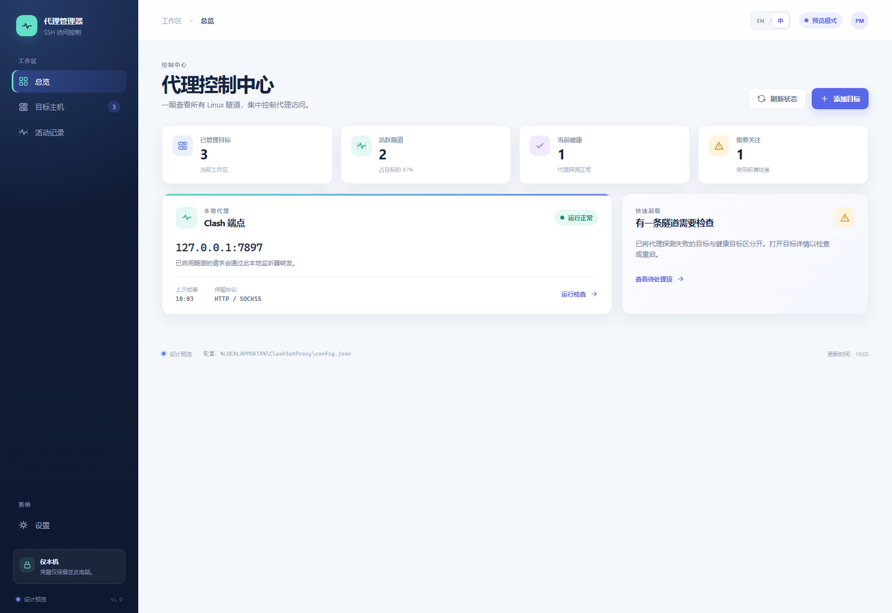
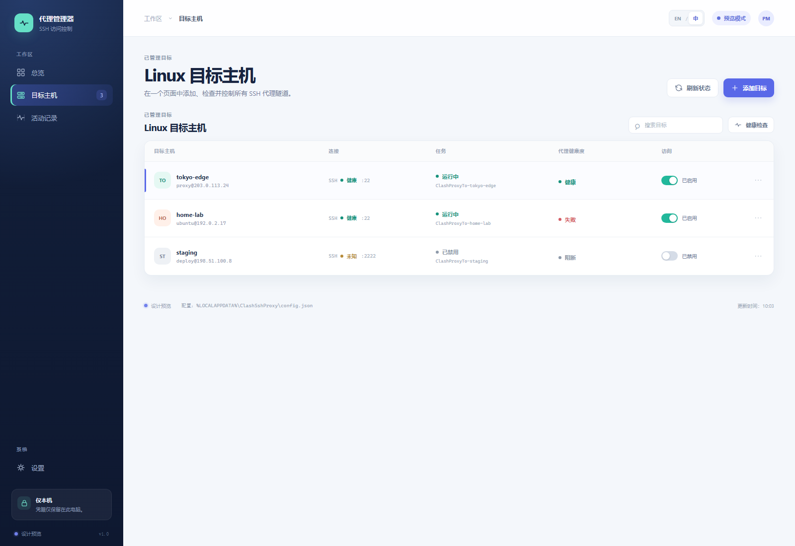
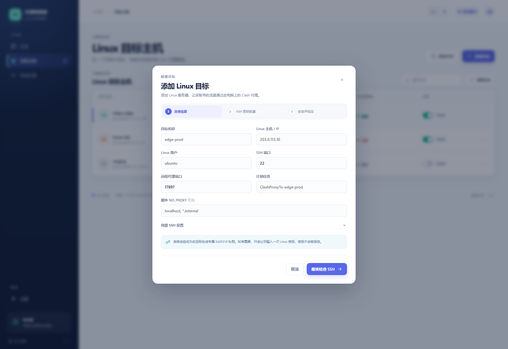
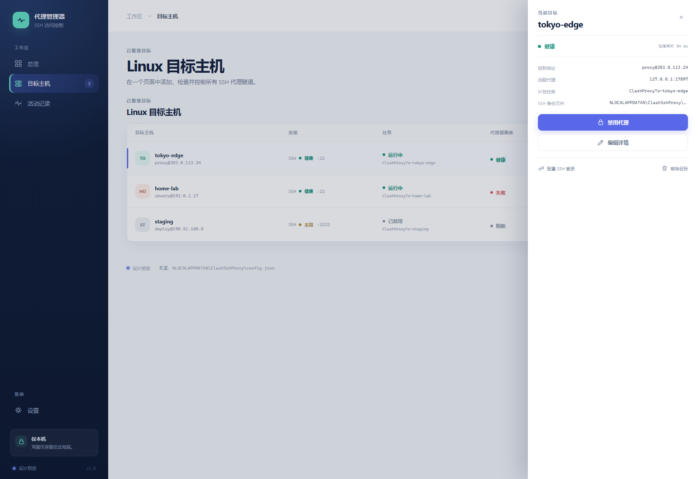
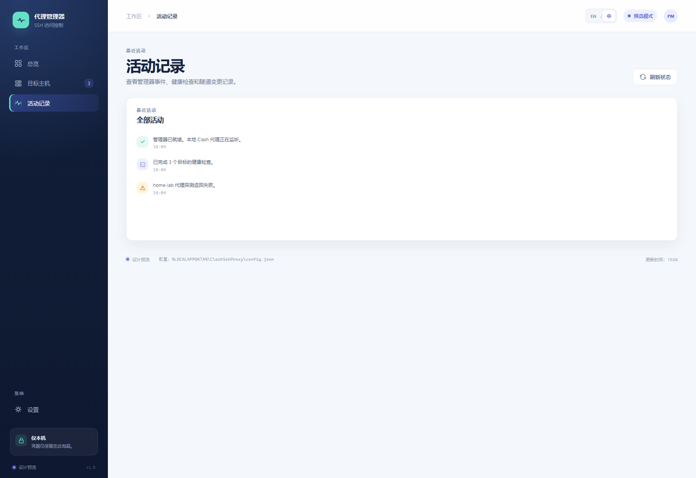

<div align="center">
  <p>
    <a href="README.md">English</a> · <strong>简体中文</strong>
  </p>
  <h1>Clash SSH Proxy Manager</h1>
  <p><strong>在 Windows 上，用一个清晰的本地 UI 管理远程 Linux 主机的 Clash SSH 代理隧道。</strong></p>
  <p>
    <a href="https://github.com/Scrates1/clash-ssh-proxy-bootstrap/releases/download/v1.2.0/clash-ssh-proxy-bootstrap-1.2.0.zip"><strong>下载 v1.2.0 ZIP</strong></a>
    ·
    <a href="https://github.com/Scrates1/clash-ssh-proxy-bootstrap/releases/latest">所有发行版</a>
    ·
    <a href="docs/WINDOWS-UI.zh-CN.md">UI 使用指南</a>
    ·
    <a href="docs/ARCHITECTURE.zh-CN.md">系统架构</a>
    ·
    <a href="https://github.com/Scrates1/clash-ssh-proxy-bootstrap/issues">问题反馈</a>
  </p>
  <p>
    <a href="https://github.com/Scrates1/clash-ssh-proxy-bootstrap/releases/latest"></a>
    <a href="https://github.com/Scrates1/clash-ssh-proxy-bootstrap/actions/workflows/ci.yml"></a>
    
    
    
  </p>
</div>

<p align="center">
  
</p>
<p align="center"><sub>总览、隧道健康度和本机 Clash 端点集中在一个窗口中。截图使用文档专用预览数据。</sub></p>

> [!IMPORTANT]
> 不需要部署 Web 服务，也不需要安装 Node.js。下载发行版 ZIP、解压、双击 `Open-ProxyManager.vbs`
> 即可启动。只有在 UI 中添加 Linux 目标时，程序才会自动完成远端脚本安装和隧道接入。

## 它解决什么问题

这是一台 Windows 控制端上的本地管理器：把远程 Linux 主机的账号流量，通过 SSH 反向隧道
转发到本机 Clash。每台目标主机独立管理，启用、禁用、更新或移除一个目标不会影响其他目标。

| 本地控制 | 多目标隔离 | 安全默认值 |
| --- | --- | --- |
| React 仪表盘统一查看总览、目标和活动记录 | 每个目标有独立任务、隧道和 SSH 私钥 | 管理器与代理端点只监听回环地址 |
| UI 完成 SSH 检查、安装、启动和健康验证 | 目标状态可以单独启用或禁用 | 密码不保存，私钥不上传 |

## 3 分钟开始

### 1. 下载并启动

1. 下载 [clash-ssh-proxy-bootstrap-1.2.0.zip](https://github.com/Scrates1/clash-ssh-proxy-bootstrap/releases/download/v1.2.0/clash-ssh-proxy-bootstrap-1.2.0.zip)（或访问 [GitHub Releases](https://github.com/Scrates1/clash-ssh-proxy-bootstrap/releases/latest)）并解压。
2. 保持 `Open-ProxyManager.vbs`、`web/dist` 和其他文件的目录结构不变。
3. 双击 `Open-ProxyManager.vbs`。
4. 出现 Windows UAC 提示时选择“是”，随后管理器会打开本机 React UI。

普通使用不需要 npm、Node.js、Docker、数据库或额外的 Web 服务器。`Open-ProxyManager.cmd`
可以作为备用入口，但优先使用 VBS 以避免黑色窗口闪烁。

关闭窗口（点击右上角 `X`）时：如果后台仍有活跃的代理任务，程序会自动最小化到任务栏右下角系统托盘（单击托盘图标可重新打开，右键可选择**退出托盘并保持后台代理运行**，或**停止所有代理并退出**）；若后台无活跃任务，则自动退出托盘释放资源。

### 2. 确认运行前置条件

- Windows 10 或 Windows 11。
- Windows OpenSSH Client（包含 `ssh.exe`、`scp.exe` 和 `ssh-keygen.exe`）。
- Clash 或兼容 HTTP 的混合代理正在监听 `127.0.0.1:7897`。
- 目标 Linux 主机可通过 SSH 访问，账号不需要 root。
- Linux 主机具备 OpenSSH server、Bash、`curl` 和标准 GNU 工具（`timeout`、`awk`、`mktemp`）。

### 3. 用 UI 添加第一台 Linux 主机

1. 进入“目标主机”，点击“添加目标”。
2. 填写目标名称、Linux 主机/IP、Linux 用户、SSH 端口和远端代理端口。
3. “高级 SSH 设置”中的私钥路径留空，让管理器自动生成该目标专属的 Ed25519 私钥。
4. 点击“继续检查 SSH”。
5. 如果远端尚未接受公钥，点击“打开 SSH 配置”。在临时 PowerShell 窗口中，若首次连接出现主机信任提示
   （`yes/no`），请先输入 `yes` 并按 Enter，待出现 `password` 提示后再输入或粘贴一次 Linux 密码并按 Enter。
   密码输入默认不回显（若 `Ctrl+V` 无效，请使用右键或 `Shift+Insert` 粘贴），密码不会被保存。
6. 回到向导点击“验证 SSH”，然后等待“安装并验证”完成。
7. 成功后，在目标列表中启用或禁用该目标，随时查看健康状态。

向导会自动安装 Linux 端运行脚本、创建 Windows 计划任务、启动反向隧道并验证端到端代理连通性。

### 4. 在 Linux 终端中使用

新打开的 Bash 登录会话会自动启用代理；已经打开的旧终端执行一次 `source ~/.bashrc` 即可生效：

```bash
source ~/.bashrc   # 在已打开的终端中立即加载
proxy_status       # 检查反向代理连通性
proxy_off          # 在当前终端临时关闭代理变量
proxy_on           # 在当前终端重新开启代理变量
```

## UI 操作流程

<table>
  <tr>
    <td width="50%" valign="top">
      
      <p><strong>目标主机</strong><br>查看 SSH、计划任务、代理健康度和启用状态。</p>
    </td>
    <td width="50%" valign="top">
      
      <p><strong>新增目标</strong><br>按“连接信息 → SSH 密钥 → 安装验证”完成接入。</p>
    </td>
  </tr>
  <tr>
    <td width="50%" valign="top">
      
      <p><strong>目标详情</strong><br>编辑、启用、配置 SSH 登录、重启或移除单个目标。</p>
    </td>
    <td width="50%" valign="top">
      
      <p><strong>活动记录</strong><br>查看健康检查、隧道变化和管理器操作日志。</p>
    </td>
  </tr>
</table>

## 四个页面

| 页面 | 你可以做什么 |
| --- | --- |
| 总览 | 查看本机 Clash 是否在线、活跃隧道数量、健康状态和需要关注的目标 |
| 目标主机 | 添加、查看、编辑、启用、禁用、检查或移除目标 |
| 活动记录 | 查看健康检查、启动恢复、启用/禁用和移除事件 |
| 设置 | 切换中文和英文，并管理新版本更新提醒（稍后提醒、跳过此版本、不再提示） |

点击目标行会打开独立的目标详情抽屉，不会把页面下拉到其他区域。刷新时 UI 保留当前布局，
加载真实本地状态，不会生成占位伪数据。

## 密钥和安全

- 每个目标拥有稳定的目标 ID 和独立的本机 Ed25519 私钥。
- 精确重复判断使用“服务器地址 + 用户名”；SSH 端口是连接参数，不是目标唯一性。
- Windows 保存私钥，Linux 账号接收对应的公钥。
- 删除目标时，UI 会明确询问是否同时删除管理器生成的专属私钥（若远端服务器已离线或退订销毁，也支持仅清理本机配置与任务）；外部私钥会始终保留。
- 管理器桥接服务和 Linux 代理端点均只监听 `127.0.0.1`。
- Linux 账号本身不会被删除，禁用一个目标也不会影响其他服务器。

## CLI 与 AI Agent 集成

除了图形界面，所有管理与诊断能力也统一通过 `proxy-manager.ps1` 提供（单一入口，支持 `-Json` 结构化输出）：

- **一键自检**：`.\proxy-manager.ps1 doctor`（或 `-Json`）可一次检查配置合法性、管理员权限状态、本机 Clash 连通性、全部目标健康度以及未引用的孤儿托管密钥。
- **禁密码/云服务器免密引导**：如果远端 Linux 禁用了密码登录、但本机已有免密私钥，可在 UI 向导的 SSH 步骤或命令行显式传入 `-BootstrapIdentityFile ~/.ssh/id_ed25519`，临时借用该钥匙部署**新生成的独立托管公钥**（原有私钥绝不会写入配置）：
  ```powershell
  $prep = .\proxy-manager.ps1 prepare-ssh -Name edge-prod -RemoteHost 203.0.113.10 -RemoteUser ubuntu -Json | ConvertFrom-Json
  .\proxy-manager.ps1 bootstrap-key -Name edge-prod -TargetId $prep.TargetId -RemoteHost 203.0.113.10 -RemoteUser ubuntu -BootstrapIdentityFile ~/.ssh/id_ed25519 -Json
  .\proxy-manager.ps1 add -Name edge-prod -TargetId $prep.TargetId -RemoteHost 203.0.113.10 -RemoteUser ubuntu -Confirm:$false -Json
  ```
- **内置 AI 规范**：仓库内置 [AGENTS.md](AGENTS.md) 与 [skills/clash-ssh-proxy/SKILL.md](skills/clash-ssh-proxy/SKILL.md)，约束 Coding Agent（Antigravity / Codex / Claude Code / Cursor）统一走 `proxy-manager.ps1`，禁止手改 `config.json` 或复用私钥。

## 常见问题

### 日常使用哪个启动入口？关闭网页后怎么重新打开？

日常使用 `Open-ProxyManager.vbs` 即可（`Open-ProxyManager-React.vbs` 打开的是同一界面）。关闭窗口（`X`）时若有活跃后台隧道会自动最小化到系统托盘，不会停止隧道；单击托盘图标或再次双击 `Open-ProxyManager.vbs` 即可重新打开界面。

### 需要部署吗？

不需要部署管理器。它是一个本地 Windows 应用：下载、解压、双击启动即可。
“添加目标”时发生的远端安装，是把某台 Linux 主机的账号接入代理隧道，不是部署 Web 服务。

### 为什么首次添加目标会出现 PowerShell 窗口？

只有在远端尚未接受 SSH 公钥时才会出现。若首次连接提示确认主机指纹（`yes/no`），请先输入 `yes` 并按 Enter；出现 `password` 提示后再输入或粘贴一次 Linux 密码并按 Enter。SSH 的密码输入默认不回显（不会显示字符或星号；若 `Ctrl+V` 无效请使用右键或 `Shift+Insert` 粘贴），密码不会保存。

### 本机 Clash 显示离线或使用了其他端口怎么办？

先启动 Clash，确认混合端口监听 `127.0.0.1:7897`，然后在“总览”点击“刷新状态”。如果本机代理监听其他端口（如 `7890`），可在 `%LOCALAPPDATA%\ClashSshProxy\config.json` 中修改 `proxy.localPort`（若已存在目标，再执行 `.\proxy-manager.ps1 update-all` 同步隧道）。

### 如何深入排障？

- [中文 Windows UI 使用指南](docs/WINDOWS-UI.zh-CN.md)
- [English Windows UI Guide](docs/WINDOWS-UI.en-US.md)
- [系统架构（中文）](docs/ARCHITECTURE.zh-CN.md) · [System Architecture (EN)](docs/ARCHITECTURE.en-US.md)
- [安全说明](SECURITY.md)
- [更新记录](CHANGELOG.md)

## 项目信息

当前控制端支持 Windows；Linux 是被管理的目标主机，Linux/macOS 控制端暂未接入。
项目使用 React/Vite 构建界面，PowerShell 提供本地桥接和隧道管理。普通用户不需要构建前端。

[English README](README.md) · [License: MIT](LICENSE)
