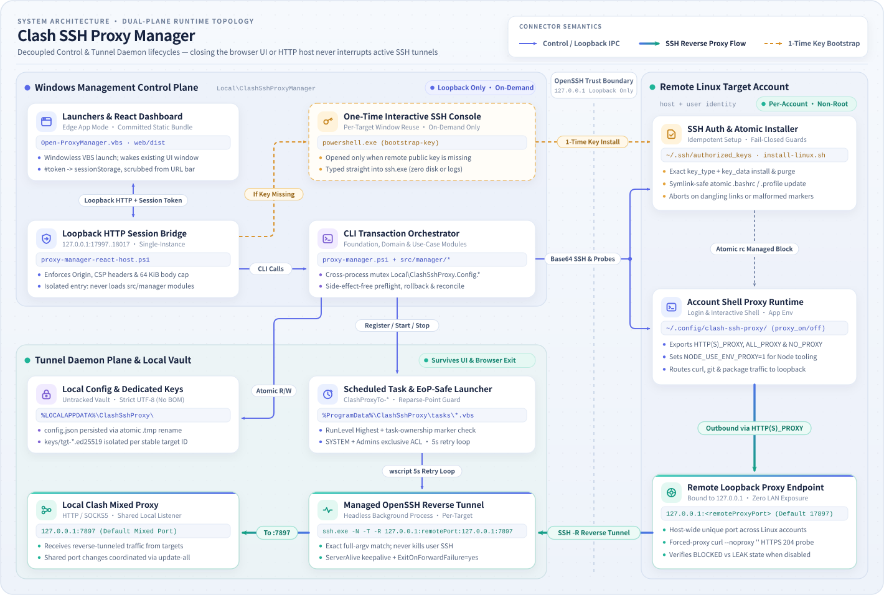

# System Architecture

For the Chinese version, see [系统架构](ARCHITECTURE.zh-CN.md).

Clash SSH Proxy Manager is a local Windows controller that routes outbound traffic from remote Linux accounts to a local Clash mixed proxy over SSH reverse tunnels.

The repository root keeps only stable user-facing launchers, CLI/host entry points, and configuration contracts. Implementation code lives under `src`, `web`, and `linux`, while automated regressions live under `tests`. Real target configurations and manager-generated keys live exclusively under `%LOCALAPPDATA%\ClashSshProxy\` and are never tracked in Git.

## Runtime Topology

At runtime the system separates the **Management Control Plane** from the **Tunnel Daemon Plane**: closing the browser dashboard or stopping the local HTTP bridge never interrupts active SSH reverse tunnels.

<p align="center">
  <picture>
    <source media="(prefers-color-scheme: dark)" srcset="diagrams/architecture-en.dark.svg">
    
  </picture>
</p>

## Code and Directory Layout

```text
clash-ssh-proxy-bootstrap/
├── Open-ProxyManager.vbs          # Default windowless launcher and smoke-test forwarder
├── Open-ProxyManager-React.vbs    # Explicit fallback VBS launcher for the React UI
├── Open-ProxyManager.cmd          # CMD compatibility wrapper handing off to VBS
├── Open-ProxyManager-React.cmd    # Explicit fallback CMD wrapper for the React UI
├── proxy-manager.ps1              # CLI parameter binding, mutation lock, and command orchestration
├── proxy-manager-react-host.ps1   # Loopback HTTP API, static asset host, and browser session bridge
├── config.schema.json             # JSON Schema contract for configuration files
├── config.example.json            # Sanitized sample configuration for validation and smoke tests
├── VERSION                        # Single source of truth for release version checks
├── CONTRIBUTING.md                # Local verification and release workflow rules
├── SECURITY.md                    # Loopback boundary, session-token, and account-isolation model
├── docs/
│   ├── diagrams/                  # Bilingual light/dark native vector architecture SVGs
│   ├── screenshots/               # Sanitized preview UI screenshots for documentation
│   ├── ARCHITECTURE.zh-CN.md      # Chinese system architecture and boundary guide
│   ├── ARCHITECTURE.en-US.md      # English system architecture and boundary guide
│   ├── WINDOWS-UI.zh-CN.md        # Chinese Windows UI user and troubleshooting guide
│   └── WINDOWS-UI.en-US.md        # English Windows UI user and troubleshooting guide
├── web/
│   ├── src/                       # React/Vite dashboard, session hooks, validation, and i18n strings
│   ├── e2e/                       # Live Edge browser regressions for session, redaction, and reload
│   └── dist/                      # Committed production bundle (so end users do not need Node.js)
├── src/
│   ├── Common.ps1                 # Default config path, strict UTF-8 reader, argv quoting, action errors
│   ├── manager/
│   │   ├── Config.ps1             # Config validation, target ID/managed key derivation, cross-process lock
│   │   ├── Transport.ps1          # OpenSSH argv builders, Base64 remote script encoding, generic probes
│   │   ├── SshBootstrap.ps1       # Atomic local key creation, key-auth preflight, interactive key install
│   │   ├── TunnelProcess.ps1      # Exact SSH command-line parsing, signature matching, process termination
│   │   ├── Tunnel.ps1             # Scheduled-task ownership checks, ACL-hardened launcher, tunnel lifecycle
│   │   ├── Remote.ps1             # Staged Linux installer upload, remote port preflight, proxy health probes
│   │   └── Operations.ps1         # Target install/rollback, enable/disable, reconcile, and status reporting
│   └── ui/
│       ├── Bootstrap.ps1          # Elevation check, single-instance mutex, window activation, UI child tracking
│       └── Http.ps1               # Static path traversal guards, Origin/body validation, CSP headers, smoke test
├── linux/
│   ├── install-linux.sh           # Linux startup validation, one-time backup, runtime install, atomic updates
│   ├── uninstall-linux.sh         # Managed startup-block removal and directory archive or --purge cleanup
│   ├── check-linux.sh             # Linux local listener check and end-to-end HTTPS proxy verification
│   └── runtime/                   # proxy_on / proxy_off / proxy_status helpers installed to ~/.config/
└── tests/
    ├── Test-Manager.ps1           # Primary Windows CLI, React host, doc-anchor, and entry-size test suite
    ├── Test-Hardening.ps1         # UTF-8, config invariants, task migration, ACL, and failure-injection suite
    ├── Test-UiLifecycle.ps1       # Single-instance reopen and browser sleep / clock-jump survival suite
    ├── Test-RemoteTransport.ps1   # Quoting, whitespace, and special-character SSH transport suite
    ├── test-linux.sh              # Linux install/uninstall idempotency, symlink, and malformed-block suite
    ├── test-proxy-health.sh       # Forced-proxy HTTPS health check and authorized_keys cleanup suite
    ├── proxy-health-fixture.py    # Local TLS origin and good/bad HTTP CONNECT proxy fixture
    └── test-privacy.sh            # Tracked-file check for sensitive paths, credentials, and private IPv4s
```

The unified frontend check is `cd web; npm run check`, which runs ESLint, Vitest unit tests, TypeScript type-checking, and the production Vite build. CI then verifies `web/dist` has no uncommitted drift. Pushing a `v<version>` tag re-runs the Linux and dual PowerShell (5.1 and 7) suites, checks that `VERSION` and `web/package.json` match the tag, and publishes a release ZIP with a SHA-256 checksum.

## Module Layering and Dependency Direction

- **Strict separation between the two PowerShell entry points**:
  - `proxy-manager.ps1` loads `src/Common.ps1` and all `src/manager/*` modules, owning CLI parameter routing, cross-process mutation locking, and top-level rollback coordination.
  - `proxy-manager-react-host.ps1` loads **only** `src/Common.ps1`, `src/ui/Bootstrap.ps1`, and `src/ui/Http.ps1`; it never dot-sources `src/manager`. It reads local config snapshots directly for responsive UI rendering and delegates every state mutation, SSH readiness check, and remote probe to `proxy-manager.ps1`.
  - Line-count guards in `tests/Test-Manager.ps1` keep `proxy-manager.ps1` under 300 lines and `proxy-manager-react-host.ps1` under 500 lines so implementation logic cannot accumulate back into public entry scripts.
- **Internal `src/manager` layering**:
  - Foundation: `Config.ps1` and `Transport.ps1` provide schema validation, canonical path resolution, and SSH transport primitives without depending on higher layers.
  - Domain modules: `SshBootstrap.ps1`, `TunnelProcess.ps1`, `Tunnel.ps1`, and `Remote.ps1` isolate SSH keys, exact Windows SSH process matching, Task Scheduler lifecycle, and Linux remote state.
  - Use-case orchestration: `Operations.ps1` composes domain modules for `Install-Target`, `Enable-TargetAccess`, `Disable-TargetAccess`, `Invoke-EnabledTargetReconciliation`, and `Get-TargetStatus`.
- **Frontend and host boundary**:
  - The React client in `web/src` talks exclusively to the loopback HTTP API (`/api/state`, `/api/heartbeat`, `/api/action`).
  - `use-manager-session.ts` isolates initial snapshot loading, non-overlapping 10-second heartbeats, focus/visibility/online recovery refreshes, and stale-response race guards; `manager-state.ts` normalizes PowerShell JSON payloads and form conversions; `target-validation.ts` surfaces immediate client-side port-conflict hints while server-side validation remains authoritative.

## Configuration Model, Uniqueness, and Concurrency Locks

- **Stable target IDs and dedicated keys**: Every new target receives a stable `tgt-<32hex>` ID (legacy entries without an `id` derive a deterministic `tgt-legacy-<sha256>` ID from the target name). When no external key is specified, the manager derives a dedicated Ed25519 key path at `%LOCALAPPDATA%\ClashSshProxy\keys\<id>.ed25519` with `identityManaged = true`. Targets may never share a private-key path.
- **Connection uniqueness and case-sensitivity rules**:
  - `host + user` defines SSH account uniqueness; `sshPort` is a connection parameter rather than target identity. Cross-target duplicate detection (`Get-TargetConnectionKey`) normalizes trimmed `host` and `user` values case-insensitively so visually ambiguous duplicate accounts cannot be added.
  - Existing targets cannot change `host` or `user` in place (`Assert-TargetConnectionUnchanged` rejects edits with `TARGET_CONNECTION_CHANGE_NOT_SUPPORTED` before any tool, network, or task side effects). Changing servers or accounts requires removing the old target first so its remote integration and task are cleaned up. During this in-place check, `host` is compared case-insensitively (`OrdinalIgnoreCase`) while Linux `user` is compared strictly case-sensitively (`Ordinal`).
  - `host + remoteProxyPort` is also unique across all targets on the same host (`REMOTE_PROXY_PORT_ASSIGNED`): loopback ports (`127.0.0.1:<port>`) belong to the Linux network namespace of the host rather than an individual user account, so two accounts on the same machine cannot share a tunnel listening port.
- **Field update semantics**: Passing an explicit empty `NoProxyExtra` clears saved entries, whereas omitting the parameter preserves existing entries. When other targets already exist, single-target `add`, `adopt`, or `update` commands refuse to override the shared `LocalProxyHost` or `LocalProxyPort`; shared proxy changes must run through `update-all`.
- **Cross-process mutation lock vs. segmented `reconcile` lock**:
  - Mutating commands (`add`, `adopt`, `prepare-ssh`, `bootstrap-key`, `enable`, `disable`, `update`, `update-all`, `install-all`, `remove`) acquire a named mutex `Local\ClashSshProxy.Config.<sha256(canonicalPath)>` in `proxy-manager.ps1` and write UTF-8 (no BOM) atomically via `.tmp.$PID` rename.
  - `reconcile` intentionally avoids holding a top-level lock while waiting for the local Clash port to come online; once Clash is reachable, it acquires short per-target locks sequentially and re-reads the latest config before restarting stopped enabled tasks.

## Security and Session Lifecycle Boundaries

- **Loopback-only listeners**: Both the Windows HTTP management bridge (`127.0.0.1:17997..18017`) and the Linux SSH reverse-forward listener (`127.0.0.1:<remoteProxyPort>`) bind exclusively to `127.0.0.1`.
- **Browser session token and HTTP defenses**:
  - Each host process mints a random bearer token and passes it in `#token=...` so it is never sent in the initial HTTP request line or Referer. The React client stores the token in per-tab `sessionStorage` (falling back to the current `history.state` entry in restricted environments) and strips it from the visible URL via `history.replaceState`. Reloading the tab preserves authorization without creating persistent credentials across closed tabs.
  - Every `/api/*` request validates `X-Proxy-Manager-Token`, enforces a same-origin `http://127.0.0.1:<boundPort>` check when `Origin` is present (`403` on mismatch), and caps request bodies at 64 KiB (`413`). Every response sets restrictive `Content-Security-Policy`, `X-Frame-Options`, `Cross-Origin-Resource-Policy`, `Referrer-Policy`, `Permissions-Policy`, and `X-Content-Type-Options` headers.
  - Static file serving decodes `RawUrl` directly, rejects control or wildcard characters with `400`, blocks path traversal outside `web/dist` with `403`, and turns unhandled per-request exceptions into logged `500` responses without stopping the listener.
  - Smoke tests send real static, unauthenticated, authenticated, and cross-origin requests against a live listener; Edge E2E (`web/e2e/manager-session.spec.mjs`) verifies initial load, URL token redaction, manual refresh, and page reload against an isolated empty configuration.
- **Single-instance host and sleep survival**:
  - Normal launches coordinate through `Local\ClashSshProxyManager` and its paired `AutoResetEvent` (smoke and browser tests use isolated `Local\ClashSshProxyManager.Smoke.<PID>` handles). Launching again brings the existing Edge app window forward or opens a fresh authorized window if the browser was closed.
  - The host stays alive for the duration of the Windows logon session rather than treating throttled or suspended browser heartbeats as an exit signal. `tests/Test-UiLifecycle.ps1` injects host-local clock jumps of 2 minutes and 2 hours to verify that existing tabs recover seamlessly on focus, visibility, or network restoration.
- **Elevation-of-privilege (EoP) protection for task launchers**:
  - Tunnel scheduled tasks run with `RunLevel Highest` via `wscript.exe` executing `%ProgramData%\ClashSshProxy\tasks\<name>.vbs`.
  - `Tunnel.ps1` verifies that launcher directories are regular directories (never reparse points), strips ACL inheritance via `icacls.exe`, and restricts ownership and `FullControl` exclusively to `SYSTEM` (`S-1-5-18`) and `Administrators` (`S-1-5-32-544`) so unprivileged local processes cannot tamper with elevated task scripts.
- **Remote script encoding and forced-proxy health checks**:
  - `ConvertTo-RemoteScriptCommand` UTF-8 Base64-encodes LF-normalized shell scripts and pipes them to remote `sh`, preventing Windows PowerShell 5.1 native argument quoting from stripping embedded double quotes (`tests/Test-RemoteTransport.ps1`).
  - Health probes test `127.0.0.1:<remoteProxyPort>` directly with `curl --noproxy '' -x ...` against multiple HTTPS `generate_204` endpoints so neither `NO_PROXY` nor older remote scripts can produce false positives; disabled targets instead probe whether the loopback port is `BLOCKED` or unexpectedly still listening (`LEAK`), covered by `tests/test-proxy-health.sh`.

## Target Lifecycle Transaction Boundaries

1. **Side-effect-free preflight**: Before touching remote files or Windows tasks, `Install-Target` in `Operations.ps1` verifies connection immutability, administrator elevation, scheduled-task ownership/conflict availability, local OpenSSH tools, private-key presence, local Clash port reachability, batch-mode SSH login, absence of pre-existing unmanaged `~/.config/clash-ssh-proxy` state on first-time `add`, and live remote loopback port availability (`Assert-RemoteProxyPortAvailable`) when enabled.
2. **Task ownership safety**: `Tunnel.ps1` verifies task ownership through its managed description marker or launcher path and never uses `-Force` to overwrite an unrelated scheduled task. Renaming a task stops and unregisters the old task before registering the replacement.
3. **Exact SSH process matching**: `TunnelProcess.ps1` parses the full `Win32_Process` command line for `ssh.exe` and matches executable, `-N -T`, identity path, SSH port, exact `-R 127.0.0.1:...` forward specification, keepalive/batch flags, and `user@host`, preventing accidental termination of unrelated user SSH sessions.
4. **Install and batch-update rollback**:
   - If task registration, tunnel startup, end-to-end proxy verification, or config persistence fails, the newly registered task and `.vbs` launcher are stopped and removed.
   - First-time `add` also rolls back the newly installed Linux shell integration, whereas a failed `update` leaves existing remote runtime files in place for retry without keeping a broken new tunnel active.
   - `config.json` is saved only after verification succeeds; if any target fails during `update-all` or `install-all`, every target already updated in that run is rolled back and stopped so persisted config and active tasks stay consistent.
5. **Removal order (`remove`)**:
   - **First**, runs remote `uninstall-linux.sh --purge` and atomically strips the exact matching `key_type + key_data` from a regular `~/.ssh/authorized_keys` file (unless `-SkipRemoteUninstall` is explicitly supplied for an unreachable host);
   - **Second**, stops and unregisters the Windows scheduled task and removes its `%ProgramData%\ClashSshProxy\tasks` launcher;
   - **Third**, when `-DeleteIdentityFile` is requested, deletes the local private key and `.pub` file only if `identityManaged` is true and the path matches the managed key directory (external keys are never deleted, and `-DeleteIdentityFile` is rejected when `-SkipRemoteUninstall` is set);
   - **Finally**, updates and saves `config.json`.
6. **Atomic Linux startup-file updates**: `linux/install-linux.sh` and `uninstall-linux.sh` validate `.bashrc` and the selected login file (`.bash_profile`, `.bash_login`, or `.profile`) before writing. Symlinks to regular files are resolved and atomically updated at their target path so symlink nodes remain intact; dangling symlinks, non-regular files, symlinked backups or managed outputs, and malformed `# >>> clash-ssh-proxy >>>` markers fail closed (`tests/test-linux.sh`).

## One-Click SSH Bootstrap and Privacy Boundaries

1. **Single SSH identity module**: Local Ed25519 key generation (via atomic temp files), passphraseless readability verification, public-key derivation/normalization, batch-mode readiness checks, and idempotent remote `authorized_keys` installation live solely in `src/manager/SshBootstrap.ps1`.
2. **Separated silent preflight and interactive setup**: `prepare-ssh` in `proxy-manager.ps1` silently ensures a local key pair exists and returns key-login readiness JSON, whereas `bootstrap-key` performs the one-time interactive public-key install; entry scripts contain no key-format logic.
3. **Onboarding vs. existing-target repair in the UI**: Both the new-target wizard and the existing-target **Configure SSH login** repair flow in `web/src/App.tsx` call `prepare-ssh` first and ask the React host to open an interactive PowerShell console for `bootstrap-key` only when `InteractionRequired` is true. Repairing SSH on an existing target stops at reporting login readiness without reinstalling remote files or changing `enabled`.
4. **Per-target console reuse**: The React host tracks active `bootstrap-key` child processes per target (`$script:SshBootstrapProcesses`) and activates an already open console window rather than spawning duplicate password prompts.
5. **Zero password persistence**: No console opens when key login already works. When a remote account has not accepted the public key yet, the user enters the Linux password once directly into `ssh.exe` inside the interactive console; passwords never enter PowerShell parameters, HTTP requests, logs, or `config.json`. Covered by `tests/Test-Manager.ps1` and `tests/Test-Hardening.ps1`.
6. **Repository privacy gate**: `tests/test-privacy.sh` scans all Git-tracked files locally and in CI to block sensitive state filenames, private-key or token signatures, and machine-specific private IPv4 addresses.

These boundaries exist not to multiply files, but so that configuration contracts, Windows scheduled tunnels, Linux shell integration, and the React browser session can evolve and be verified independently.
