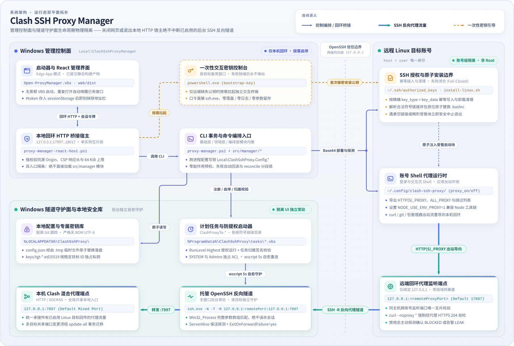

# 系统架构

English version: [System Architecture](ARCHITECTURE.en-US.md)

Clash SSH Proxy Manager 是运行在 Windows 控制端上的本地代理隧道管理器，通过 SSH 反向转发将远程 Linux 主机账号的出站流量导向本机 Clash 混合代理端口。

仓库根目录只保留用户或脚本直接调用的稳定入口与配置契约；核心实现位于 `src`、`web` 与 `linux`，自动化回归位于 `tests`。真实目标配置与托管密钥只保存在 `%LOCALAPPDATA%\ClashSshProxy\`，不会进入 Git 跟踪内容。

## 运行态拓扑

系统在运行态拆分为**管理控制面**与**隧道守护面**两个独立生命周期：关闭管理网页甚至退出本地 HTTP 宿主，都不会中断已启用的后台 SSH 隧道。

<p align="center">
  <picture>
    <source media="(prefers-color-scheme: dark)" srcset="diagrams/architecture-zh.dark.svg">
    
  </picture>
</p>

## 代码与目录结构

```text
clash-ssh-proxy-bootstrap/
├── Open-ProxyManager.vbs          # 默认无黑框启动器与 smoke-test 转发
├── Open-ProxyManager-React.vbs    # React 界面显式备用 VBS 启动器
├── Open-ProxyManager.cmd          # 转交 VBS 的 CMD 兼容入口
├── Open-ProxyManager-React.cmd    # React 界面显式备用 CMD 入口
├── proxy-manager.ps1              # CLI 参数绑定、跨进程锁与命令编排入口
├── proxy-manager-react-host.ps1   # 回环 HTTP API、静态资源宿主与浏览器会话管理
├── config.schema.json             # 配置文件 JSON Schema 契约
├── config.example.json            # 脱敏示例配置（供校验与冒烟测试使用）
├── VERSION                        # 发布版本号单一事实来源
├── CONTRIBUTING.md                # 本地检查、双宿主测试与发版约定
├── SECURITY.md                    # 回环边界、会话令牌与多账号隔离说明
├── docs/
│   ├── diagrams/                  # 中英双语、日夜自适应原生矢量架构拓扑图 (SVG)
│   ├── screenshots/               # 文档使用的脱敏预览界面截图
│   ├── ARCHITECTURE.zh-CN.md      # 中文系统架构与边界说明
│   ├── ARCHITECTURE.en-US.md      # 英文系统架构与边界说明
│   ├── WINDOWS-UI.zh-CN.md        # 中文 Windows UI 使用与排障指南
│   └── WINDOWS-UI.en-US.md        # 英文 Windows UI 使用与排障指南
├── web/
│   ├── src/                       # React/Vite 仪表盘、会话管理、校验与中英文资源
│   ├── e2e/                       # Edge 真实浏览器会话、脱敏与重载回归
│   └── dist/                      # 已提交的前端生产构建产物（免除用户安装 Node.js）
├── src/
│   ├── Common.ps1                 # 默认配置路径、严格 UTF-8 读取、参数转义与结构化异常
│   ├── manager/
│   │   ├── Config.ps1             # 配置校验、目标 ID/托管私钥派生、唯一性与跨进程写锁
│   │   ├── Transport.ps1          # OpenSSH 参数构造、远端脚本 Base64 编码与通用探测
│   │   ├── SshBootstrap.ps1       # 本机密钥原子生成、免密预检、交互式公钥安装与清理
│   │   ├── TunnelProcess.ps1      # 精确 SSH 命令行解析、签名匹配与托管进程停止
│   │   ├── Tunnel.ps1             # Windows 计划任务归属校验、ACL 加固启动器与隧道启停
│   │   ├── Remote.ps1             # Linux 脚本分阶段上传安装、端口占用探测与代理健康检查
│   │   └── Operations.ps1         # 目标安装/回滚、启停、顺序恢复（reconcile）与状态汇总
│   └── ui/
│       ├── Bootstrap.ps1          # 管理员状态检查、单实例互斥锁、窗口唤醒与交互进程跟踪
│       └── Http.ps1               # 静态资源路径防护、Origin/大小校验、安全响应头与冒烟自检
├── linux/
│   ├── install-linux.sh           # Linux 账号侧校验、首次备份、运行时安装与启动文件原子更新
│   ├── uninstall-linux.sh         # 启动文件受管块移除与配置目录归档或彻底清理（--purge）
│   ├── check-linux.sh             # Linux 本机端口与端到端 HTTPS 代理连通性自检
│   └── runtime/                   # 部署到 ~/.config/clash-ssh-proxy/ 的 proxy_on/off/status 脚本
└── tests/
    ├── Test-Manager.ps1           # Windows CLI、React 宿主、文档锚点与入口体积回归总入口
    ├── Test-Hardening.ps1         # UTF-8、配置约束、任务迁移、ACL 与失败回滚注入回归
    ├── Test-UiLifecycle.ps1       # 单实例唤醒、浏览器休眠/时钟跳跃后的会话存活回归
    ├── Test-RemoteTransport.ps1   # 远端命令引号、空白与特殊字符跨 SSH 传输回归
    ├── test-linux.sh              # Linux 安装/卸载幂等性、符号链接保护与畸形标记拒绝回归
    ├── test-proxy-health.sh       # 强制经由代理的 HTTPS 健康检查与 authorized_keys 清理回归
    ├── proxy-health-fixture.py    # 本地 TLS 靶机与有效/无效 HTTP CONNECT 代理测试夹具
    └── test-privacy.sh            # Git 跟踪文件敏感路径、密钥/令牌特征与私网 IPv4 扫描
```

前端统一验证入口是 `cd web; npm run check`，依次执行 ESLint、Vitest 单元测试、TypeScript 类型检查和 Vite 生产构建。CI 随后比对 `web/dist`，拒绝源码与提交静态包漂移。推送 `v<version>` 标签还会复跑 Linux 与双版本 PowerShell（5.1 / 7）回归、核对 `VERSION` 与 `web/package.json` 版本一致，并生成归档 ZIP 与 SHA-256 校验文件。

## 模块分层与依赖方向

- **双入口物理隔离**：
  - `proxy-manager.ps1` 加载 `src/Common.ps1` 与 `src/manager/*` 全部模块，负责 CLI 参数校验、写命令互斥锁与顶层回滚编排。
  - `proxy-manager-react-host.ps1` **只加载** `src/Common.ps1`、`src/ui/Bootstrap.ps1` 与 `src/ui/Http.ps1`，不直接加载 `src/manager` 内部函数。宿主仅直接读取本地配置文件生成低延迟结构快照，所有状态变更、SSH 预检与远端健康探测均通过调用 `proxy-manager.ps1` 完成。
  - `tests/Test-Manager.ps1` 对公共入口实施行数上限守卫（`proxy-manager.ps1` < 300 行、`proxy-manager-react-host.ps1` < 500 行），防止业务逻辑回流到入口脚本。
- **Manager 内部层次**：
  - 基础层：`Config.ps1` 与 `Transport.ps1` 提供配置契约、路径规范化与跨平台 SSH 命令传输，不依赖上层业务。
  - 领域层：`SshBootstrap.ps1`、`TunnelProcess.ps1`、`Tunnel.ps1` 与 `Remote.ps1` 分别封装密钥生命周期、SSH 进程签名、Windows 计划任务和 Linux 远端运行时。
  - 编排层：`Operations.ps1` 组合各领域模块实现安装、启用、禁用、顺序恢复（`reconcile`）与状态探测用例。
- **前端与宿主职责边界**：
  - React 前端位于 `web/src`，仅通过回环 HTTP API（`/api/state`、`/api/heartbeat`、`/api/action`）读写状态。
  - `use-manager-session.ts` 隔离初始加载、10 秒心跳、焦点/可见性/网络恢复刷新及请求竞态保护；`manager-state.ts` 负责 PowerShell 返回结构归一化与表单转换；`target-validation.ts` 在前端提前提示同主机端口冲突并推荐可用端口，最终仍由后端强制校验。

## 配置模型、唯一性与并发锁

- **稳定目标 ID 与专属密钥**：新增目标分配稳定的 `tgt-<32位十六进制>` ID（旧配置缺省时按目标名 SHA-256 派生确定性的 `tgt-legacy-...` ID）。未显式指定外部私钥时，管理器按 ID 在 `%LOCALAPPDATA%\ClashSshProxy\keys\<id>.ed25519` 派生专属托管私钥并标记 `identityManaged = true`；不同目标禁止共享同一私钥路径。
- **连接唯一性与大小写语义**：
  - `host + user` 定义目标账号唯一性，`sshPort` 只是连接参数而非目标身份。跨目标查重（`Get-TargetConnectionKey`）对去除首尾空白后的 `host` 与 `user` 均按小写归一化比较，防止录入仅大小写不同的易混淆重复目标。
  - 已有目标的 `host` 与 `user` 禁止原地修改（`Assert-TargetConnectionUnchanged` 在 CLI 目标构造和 `Install-Target` 入口均会在产生任何副作用前抛出 `TARGET_CONNECTION_CHANGE_NOT_SUPPORTED`）；更换服务器或账号必须先删除旧目标以清理安装，再重新添加。此处 `host` 比较忽略大小写，而 Linux `user` 比较严格区分大小写（`Ordinal`）。
  - 同一主机跨账号的 `remoteProxyPort` 同样互斥（`REMOTE_PROXY_PORT_ASSIGNED`）：Linux 上的 `127.0.0.1:<port>` 属于整机回环命名空间，同一台主机上的不同账号（含已禁用目标）不得共用同一个远端代理监听端口。
- **配置字段变更语义**：表单或 CLI 显式传入空的 `NoProxyExtra` 表示清空额外绕过列表，未传该参数则保留原值。当已存在其他目标时，单目标 `add`/`adopt`/`update` 禁止顺带修改全局共享的 `LocalProxyHost` 或 `LocalProxyPort`，必须先通过 `update-all` 统一迁移。
- **跨进程写锁与 `reconcile` 分段锁**：
  - `add`、`adopt`、`prepare-ssh`、`bootstrap-key`、`enable`、`disable`、`update`、`update-all`、`install-all` 与 `remove` 在 `proxy-manager.ps1` 入口持有基于规范化配置路径 SHA-256 命名的 `Local\ClashSshProxy.Config.<hash>` 互斥锁，并通过 `.tmp.$PID` 临时文件原子替换落盘（无 BOM UTF-8）。
  - `reconcile` 不在入口长时间持锁：它先无锁轮询等待本机 Clash 端口就绪，随后按目标逐个获取短锁、重读最新配置并恢复停止的已启用任务，避免开机等待期间阻塞用户的其他管理操作。

## 安全与会话生命周期边界

- **严格回环监听**：Windows 管理桥接（`127.0.0.1:17997..18017` 动态回退）与 Linux 反向代理端点（`127.0.0.1:<remoteProxyPort>`）均硬编码绑定 `127.0.0.1`，不向局域网暴露监听端口。
- **浏览器会话令牌与 HTTP 边界**：
  - 每次启动宿主生成随机令牌并通过 `#token=...` URL fragment 传入浏览器；前端读取后存入当前标签页 `sessionStorage`（受限环境回退至当前 `history.state`），随即调用 `history.replaceState` 从地址栏抹除。页面刷新可恢复授权，关闭标签页不留持久凭据。
  - `/api/*` 同时校验 `X-Proxy-Manager-Token` 请求头、精确匹配当前绑定端口的回环 `Origin`（拒绝跨源网页请求并返回 `403`）以及 64 KiB 请求体上限（超限返回 `413`）。所有响应均附带严格的 `Content-Security-Policy`、`X-Frame-Options`、`Cross-Origin-Resource-Policy` 与 `nosniff` 响应头。
  - 静态资源从原始 `RawUrl` 解码并校验目录边界，控制字符或非法路径返回 `400`，越界路径返回 `403`；单次请求未捕获异常记录日志并返回 `500`，不会使 `HttpListener` 主循环退出。
  - Smoke test 在真实监听器上发起静态页、未授权、合法授权与跨源请求自检；Edge E2E 在空白临时配置与独立互斥锁下验证首次加载、令牌脱敏与页面刷新恢复。
- **单实例宿主与休眠恢复**：
  - 正常模式使用 `Local\ClashSshProxyManager` 单实例互斥锁及配套 `AutoResetEvent`（Smoke / 浏览器测试使用隔离的 `Local\ClashSshProxyManager.Smoke.<PID>`）。重复双击启动器会唤醒已有 Edge 应用窗口或重新打开带有效令牌的页面。
  - 单个回环宿主在当前 Windows 登录会话内保持常驻，不把浏览器后台节流或系统休眠导致的心跳暂停视为关闭应用。页面在心跳恢复、窗口聚焦、恢复可见或网络重连时自动刷新状态快照，且心跳请求不重叠。`tests/Test-UiLifecycle.ps1` 通过注入独立宿主时钟偏移模拟 2 分钟与 2 小时空闲中断，验证旧会话持续可用。
- **计划任务启动器的防提权（EoP）边界**：
  - 隧道计划任务以 `RunLevel Highest` 权限通过 `wscript.exe` 运行无窗口启动器 `%ProgramData%\ClashSshProxy\tasks\<name>.vbs`。
  - `Tunnel.ps1` 在写入前后均校验目录非重解析点（拒绝符号链接/目录联接），使用 `icacls.exe` 移除继承并强制所有者与完全控制权限仅限 `SYSTEM`（`S-1-5-18`）和 `Administrators`（`S-1-5-32-544`），防止普通权限进程通过篡改启动脚本提权。
- **远端脚本编码与真实代理探测**：
  - 远端命令与探测统一通过 `ConvertTo-RemoteScriptCommand` 将 LF 归一化的脚本做 UTF-8 Base64 编码后交由远端 `sh` 执行，彻底规避 Windows PowerShell 5.1 原生参数传递剥离内嵌双引号的问题（由 `tests/Test-RemoteTransport.ps1` 覆盖）。
  - 健康检查直接使用当前目标配置的端口执行 `curl --noproxy '' -x http://127.0.0.1:<port>` 探测多组 HTTPS `generate_204` 端点，不受环境变量 `NO_PROXY` 或旧版远端脚本干扰；已禁用目标则探测远端回环端口确认处于关闭（`BLOCKED`）还是意外监听（`LEAK`）。相关行为由 `tests/test-proxy-health.sh` 覆盖。

## 目标生命周期事务边界

1. **零副作用前置预检**：`Operations.ps1` 的 `Install-Target` 在写入任何远端或本机状态前，依次完成连接身份未变更检查、管理员权限校验、计划任务归属/重名预检、本机 OpenSSH 工具与私钥存在性检查、本机 Clash 监听检查、SSH 免密连通检查、首次接入时远端未残留旧托管目录检查，以及启用目标的远端代理端口空闲探测（`Assert-RemoteProxyPortAvailable`）。
2. **计划任务归属保护**：`Tunnel.ps1` 通过任务描述标记与启动器路径识别任务归属，绝不使用 `-Force` 覆盖无关计划任务；目标改名或更换 `taskName` 时先停止并注销旧任务，再注册新任务。
3. **精确隧道进程匹配**：`TunnelProcess.ps1` 解析 `Win32_Process` 中 `ssh.exe` 的完整命令行参数数组，逐项比对可执行文件、`-N -T`、私钥路径、SSH 端口、精确 `-R 127.0.0.1:...` 映射、保活/批处理选项与 `user@host`，绝不按主机名或端口子串误杀用户的其他 SSH 会话。
4. **安装与批量更新回滚**：
   - 计划任务注册、启动、端到端代理验证或配置落盘任一步失败时，本轮新建或替换的任务与 `.vbs` 启动器都会立即停止并移除。
   - 首次 `add` 失败还会回滚刚部署的远端 Linux Shell 集成；`update` 失败则保留远端已有运行时文件以便重试，但不会残留活动的新隧道。
   - 配置仅在全部验证通过后落盘；`update-all` / `install-all` 任一目标失败时，本轮先前已完成更新的目标也会统一回滚关闭，避免磁盘配置与运行中任务长期分裂。
5. **删除目标（`remove`）清理顺序**：
   - 默认**先**连接远端执行 `uninstall-linux.sh --purge` 并从常规文件 `~/.ssh/authorized_keys` 中按精确 `key_type + key_data` 原子移除对应公钥（远端主机已销毁时可显式指定 `-SkipRemoteUninstall` 跳过）；
   - **再**停止并注销本机 Windows 计划任务、清理 `%ProgramData%\ClashSshProxy\tasks` 下的启动器；
   - **随后**若用户勾选 `-DeleteIdentityFile`，仅在确认密钥归属为当前目标托管路径时删除本机私钥与 `.pub` 文件（外部自定义私钥永不删除，且跳过远端卸载时禁止同时删除本机私钥，以免丢失清理远端所需的公钥线索）；
   - **最后**更新并保存 `config.json`。
6. **Linux 启动文件原子更新**：`linux/install-linux.sh` 与 `uninstall-linux.sh` 在修改前先统一校验 `.bashrc` 与登录启动文件（`.bash_profile` / `.bash_login` / `.profile`）。合法符号链接会解析到真实常规文件并在原位原子替换内容，保留符号链接节点不变；遇到悬空链接、非常规文件、符号链接备份/受管产物或畸形的 `# >>> clash-ssh-proxy >>>` 托管块时直接失败退出（fail closed），由 `tests/test-linux.sh` 覆盖。

## SSH 一键引导与隐私边界

1. **单一密钥模块**：本机 Ed25519 密钥原子生成、无口令可读性校验、公钥归一化派生、免密登录预检与远端公钥幂等写入只集中在 `src/manager/SshBootstrap.ps1`。
2. **CLI 静默与交互分离**：`proxy-manager.ps1` 的 `prepare-ssh` 只负责静默准备本机密钥并返回免密就绪状态，`bootstrap-key` 承担必要的一次性交互式公钥安装；入口脚本不包含密钥解析细节。
3. **UI 引导与修复分流**：新增目标向导与已有目标的“配置 SSH 登录”修复流程位于 `web/src/App.tsx`。预检需要交互时由 React 宿主启动独立的交互式 PowerShell 窗口执行 `bootstrap-key`；已有目标修复完成后仅提示免密登录就绪，不会顺带重装远端脚本或改变目标的启用状态。
4. **单目标窗口复用**：宿主按目标跟踪已打开的 `bootstrap-key` 进程（`$script:SshBootstrapProcesses`）；同一目标窗口尚未退出时再次点击会直接前置激活该窗口，避免并行弹出多个密码输入框。
5. **密码零落盘**：已具备免密登录能力时绝不弹出控制台；仅在远端尚未接受公钥时由用户在独立控制台中直接向 `ssh.exe` 输入一次 Linux 密码，密码绝不进入参数对象、HTTP 请求、日志或配置文件。缺失密钥、已有密钥、首次交互与失败清理均由 `tests/Test-Manager.ps1` 与 `tests/Test-Hardening.ps1` 覆盖。
6. **仓库级隐私门禁**：`tests/test-privacy.sh` 在本地检查与 CI 中扫描全部 Git 跟踪文件，阻止敏感配置文件名、私钥/API 令牌特征以及机器专属私网 IPv4 地址进入版本库。

这套架构边界的目标不是追求文件拆分数量，而是让本地配置契约、Windows 守护任务、Linux 账号环境与 React 界面会话能够独立演进、独立回归验证。
